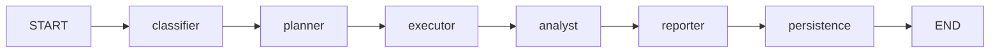

# TestMirror

TestMirror 0.3.0 是基于 LangGraph 的本地测试评估与回归诊断工具。本版以 Python / pytest 为主要验收对象，提供网页评估、CI 门禁、SQLite 历史报告和逐用例对比。Python 3.11+，使用 uv 管理依赖。

## 安装与启动

克隆仓库或解压源码后，在包含 `pyproject.toml` 的目录中打开 PowerShell。

```powershell
python -m pip install uv
uv sync --locked
if (-not (Test-Path .env)) { Copy-Item .env.example .env }
uv run --locked python -m uvicorn src.api.fastapi_server:app --host 127.0.0.1 --port 8000
```

打开 <http://127.0.0.1:8000/> 使用网页，打开 <http://127.0.0.1:8000/docs> 查看交互式 API。`config/settings.py` 自动从当前目录 `.env` 和环境变量读取配置，环境变量优先。

也支持标准 pip 安装（推荐在虚拟环境中）：

```powershell
python -m pip install .
# 需要运行测试时：
python -m pip install '.[dev]'
```

SQLite 使用 Python 标准库 `sqlite3`，无需单独安装数据库服务或 PyPI 包。`uv.lock` 固定完整依赖版本；`requirements.txt` 作为兼容入口引用 pyproject.toml。

使用前请在 TestMirror 运行测试的同一环境安装待测项目所需的依赖。可以先用仓库自带的 [pytest 示例](docs/guides/web-evaluation-复验说明.md) 验证网页流程。

## 验证

```powershell
uv run --locked python -m pytest -q
uv run --locked python scripts/validate_workflow.py
```

验证脚本会创建临时示例项目，执行完整流程，并检查五个智能体结果和 SQLite 记录。默认写入 `data/validation.db`，可用 `--db PATH` 指定其他数据库文件。

每次 pytest 评估只启动一次测试。项目配置了 `--cov` 时，TestMirror 使用 pytest-cov 本次采集的数据，沿用项目的覆盖范围和阈值。每次评估使用新的数据文件，`--cov-append` 也从空数据开始。没有配置 `--cov` 时，由可用的 `coverage.py` 采集。缺少项目所需的覆盖率工具时，测试仍会运行，网页覆盖率显示「未采集」，覆盖率阈值无法校验。

测试通过率按用例计算：通过数 ÷（通过数 + 失败数），不计跳过和可选覆盖率命令。未识别到有效用例或全部用例跳过时，状态为「执行失败」，通过率返回 `null`。综合参考分需要有效的通过率和覆盖率。Jest 需要已安装 Node.js、npm 和项目依赖，并在 `package.json` 中配置 Jest 的 `test` 脚本；Go 需要 `go` 命令在 PATH 上。Jest 和 Go 分别使用 LCOV 和 Go profile 提取覆盖率，Go 的计数按顶层测试汇总。

## CI 门禁

```powershell
uv run --locked python -m src D:/path/to/project --db data/ci.db --min-coverage 80
```

标准输出包含一条 JSON 结果，运行日志写到标准错误。退出码 `0` 表示门禁通过，`1` 表示用例失败或覆盖率未达到门禁要求，`2` 表示输入、执行或落库失败。指定 `--min-coverage` 时，覆盖率未采集也会拦截。可重复使用 `--exclude-dir` 排除项目内的目录。

HTTP 调用也支持 `min_coverage`（0–100）。自动化调用者应同时检查 `persisted` 和 `metrics.quality_gate.passed`，原因记录在 `metrics.quality_gate.reason`。覆盖率门禁拦截时，已通过的用例仍显示为通过，门禁结果单独显示。

## 网页评估

启动服务后打开 <http://127.0.0.1:8000/>。点击「新建评估」，输入已存在的本地项目目录，点击「开始评估」。需要缩小临时工作副本时，展开「排除目录（可选）」，每行填写一个项目内的相对目录，例如

```text
data/raw
docs
logs
```

空行和每行首尾空白会被忽略；网页通过现有 `POST /evaluations` 的 `exclude_dirs` 数组提交。目录必须是相对路径，不能包含 `..`；排除仅影响测试用的临时副本，不会修改源项目。路径或排除目录校验失败时，表单内会显示可读错误，不需要查看原始 JSON。

「评测总览」展示最近一次结果和近期通过率。「运行记录」支持按项目、报告 ID 和状态筛选，打开报告后可查看通过率、覆盖率、执行信息和已采集的逐用例结果。「回归对比」可在保存至少两份报告后选择基线和新报告，查看逐用例变化及两次运行的依据。

失败报告保留测试输出提取的用例、文件行号和断言差异。DeepSeek 推断会标为待核实，模型生成的建议带有来源标签。展开「查看测试执行日志」可以核对捕获的测试输出。

pytest 评估从同一次运行采集逐用例结果。通过评估接口获取的报告在 `detailed_report.execution.test_case_results` 保存这组数据，其中 `node_id` 保留 pytest 的用例名和参数 ID，文件路径统一为相对测试副本的路径。`outcome` 为 `passed`、`failed` 或 `skipped`。准备或清理阶段报错计入该用例的失败，预期失败计为跳过。子测试归入父用例。

`status` 为 `complete` 时表示采集确认完整。提前停止或有用例被筛选时，已取得的结果标为 `incomplete`。收集失败、超时或采集不到结果时返回相应原因，结果可能部分可用或完全不可用。旧报告和其它测试工具没有这一组 pytest 数据。

## 评测输入追溯

新报告的「执行信息」记录测试前临时副本的 SHA-256、文件数和字节数、实际命令参数、超时与门禁规则版本。完整字段保存在 `detailed_report.execution.provenance`，门禁阈值与结果保存在 `metrics.quality_gate`。命令行 JSON 也返回副本指纹和环境信息。

`testmirror-tree-v1` 对副本内的相对路径、文件内容、权限位和空目录计算指纹。排除目录和测试运行后产生的文件不参与计算。若输入目录是 Git 工作区根目录且 Git 可用，报告也记录复制完成时观察到的 HEAD 和工作区是否干净。以副本指纹核对实际执行输入，包括未提交改动。

环境记录包括操作系统和架构。Python 测试另记录解释器与已安装的 pytest、pytest-cov、coverage 版本。这些记录可用于核对两次运行，当前临时副本会在执行后清理，系统依赖和完整依赖环境仍需由运行方提供。

0.3.0 曾在 DataMind 上验收，112 项用例全部通过，覆盖率 89.24%，通过 85% 的覆盖率门禁。可用[仓库自带的示例](docs/guides/web-evaluation-复验说明.md)在本机复现网页评估、历史报告和回归对比。

## 工作流与扩展点



五个智能体依次负责分类、规划、执行、分析和报告。`persistence` 与 `retry` 是内部控制节点。已有的规则分类器、测试命令执行器和报告逻辑保留；新分析节点提供基于执行结果的确定性分析，可在各 agent 模块中继续替换实现。

`src/core/langgraph_orchestrator.py` 导出 `State`（`WorkflowState` 的别名）、`WorkflowEngine` 和 `run_workflow`。State 的完整定义保留在 `src/models/state.py`；`state_manager.py` 校验输入路径和重试预算，为每次运行分配独立 ID 和初始状态。

```python
from src.core.langgraph_orchestrator import WorkflowEngine

with WorkflowEngine("data/testmirror.db") as engine:
    print(engine.mermaid())  # 构建并检查图，无需执行测试
    result = engine.run("D:/path/to/a/trusted/project")
    print(result["evaluation_status"], result["summary"])
    report = engine.get_report(result["evaluation_id"])
```

所有节点经过统一错误边界：异常会追加到 `errors`，并生成标准错误消息。`max_retries`（0–20）是一次运行共享的重试预算；耗尽后跳到分析/报告阶段生成部分报告。报告或持久化失败也有退出边，避免无限循环。`status` 表示工作流运行结果，`evaluation_status` 表示测试是否通过；重试成功仍保留之前的错误记录。

`run()` 返回最终状态，`stream()` 返回各节点的增量更新。默认 MemorySaver 仅保存当前进程内的 LangGraph 检查点，每次运行隔离；持久报告存放在 SQLite。相同 `evaluation_id` 在新报告完整提交后替换旧报告，写入失败时旧报告仍可读取。报告读取使用同一个数据库快照。默认生成 UUID 避免冲突。

## 消息与回调

`src/core/message_schema.py` 的 `AgentMessage` 使用 Pydantic 校验，包含版本、消息 UUID、evaluation_id、发送者、接收者、result/error 类型、JSON payload 和带时区的时间戳。节点结果自动转换为消息，并由 State 的追加 reducer 保存在 `messages` 中；成功消息发给下一阶段，异常消息发给 orchestrator。

使用 LangChain 原生回调，同时接收 `agent_start`、`agent_end`、`agent_error` 自定义事件：

```python
from langchain_core.callbacks import BaseCallbackHandler
from src.core.langgraph_orchestrator import WorkflowEngine

class Progress(BaseCallbackHandler):
    def on_custom_event(self, name, data, **kwargs):
        print(name, data["agent"])

with WorkflowEngine(":memory:") as engine:
    result = engine.run(
        "D:/path/to/a/trusted/project",
        config={"callbacks": [Progress()]},
    )
```

## API

| 方法 | 路径 | 用途 |
| --- | --- | --- |
| GET | `/health` | 健康检查 |
| GET | `/workflow` | 编译并返回工作流 Mermaid |
| POST | `/evaluations` | 同步执行评估，返回最终状态 |
| GET | `/evaluations?limit=20` | 最近评估列表；`limit` 范围 1–100，按开始时间倒序 |
| GET | `/evaluations/{evaluation_id}` | 从 SQLite 读取报告，缺失返回 404 |
| GET | `/evaluation-comparisons?baseline_id=…&current_id=…` | 对比两份已保存的评估，任一报告缺失时返回 404 |

三个评估接口契约：

```json
{
  "project_path": "D:/path/to/a/trusted/project",
  "max_retries": 2,
  "exclude_dirs": ["data/raw", "node_modules"],
  "metadata": {"source": "local"}
}
```

`POST /evaluations` 要求真实目录；`evaluation_id` 和 `max_retries` 可选，也可用相对目录列表 `exclude_dirs` 限定复制期间跳过的数据文件夹（不会修改源项目）。省略重试数时采用 `TESTMIRROR_MAX_RETRIES`。路径、字段或目录校验失败返回 422；工作流结果直接包含评估 ID、最终状态、通过率和详细报告。

`GET /evaluations?limit=2` 示例：

```json
[
  {
    "evaluation_id": "eval-new",
    "project_name": "DataMind",
    "started_at": "2026-11-18T14:02:08Z",
    "status": "test_failed",
    "pass_rate": 0.9896
  },
  {
    "evaluation_id": "eval-old",
    "project_name": "demo",
    "started_at": "2026-11-17T10:00:00Z",
    "status": "passed",
    "pass_rate": 1.0
  }
]
```

`GET /evaluations/{evaluation_id}` 返回与列表中同 ID 对应的 SQLite 报告（evaluation、五阶段结果、错误和建议）；不存在时返回 404。状态取值为 `passed`、`test_failed`、`execution_failed` 或历史记录无法判定时的 `unknown`。用例通过率 = 通过数 ÷（通过数 + 失败数），跳过数不参加分母；执行未能运行用例或未识别用例结果时为 `null`。可选覆盖率步骤失败不会当作测试用例失败。

### 评测对比

对比接口按 `node_id` 匹配同一用例。响应中的 `baseline` 和 `current` 包含两次评测的汇总、代码指纹、运行环境、门禁规则和逐用例采集状态。

- `complete` 表示两次都取得完整逐用例结果，可以判断用例增删。
- `partial` 表示双方都有逐用例数据，但至少一份采集不完整。只比较两边都记录的用例。
- `unavailable` 表示至少一份没有可用逐用例数据。仍可查看两次的汇总和采集原因。

`changes` 包含新失败（`new_failures`）、修复（`fixed`）、新增（`added`）、移除（`removed`）及跳过变化（`skip_changes`），`counts` 是各组条数。`skipped → failed` 同时属于新失败和跳过变化。`failed → skipped` 只属于跳过变化，修复要求新结果为 `passed`。新增且失败的用例在 `added` 中保留其失败状态。`warnings` 提示已知的项目路径、运行环境、排除目录或门禁策略差异。结果中缺失的上下文为 `null`。

## 目录

```text
TestMirror/
├── src/
│   ├── agents/
│   │   ├── classification_agent.py  # 可选的 DeepSeek 分类实现
│   │   ├── classifier_agent.py      # 默认规则分类器
│   │   ├── planning_agent.py
│   │   ├── execution_agent.py
│   │   ├── analysis_agent.py
│   │   ├── report_agent.py
│   │   └── persistence_agent.py     # 内部存储节点
│   ├── core/
│   │   ├── langgraph_orchestrator.py
│   │   ├── message_schema.py
│   │   ├── state_manager.py
│   │   └── deepseek_client.py
│   ├── models/
│   │   ├── database.py
│   │   └── state.py
│   ├── api/fastapi_server.py
│   └── utils/
├── tests/
├── scripts/validate_workflow.py
├── config/settings.py
├── pyproject.toml
├── uv.lock
├── requirements.txt
├── .env.example
├── .gitignore
└── README.md
```

## 可选 DeepSeek 模式

默认使用规则分类和离线分析。为 API 开启模型分类和诊断时，在 `.env` 中设置 `TESTMIRROR_USE_DEEPSEEK=true`、`DEEPSEEK_API_KEY`（也接受 `DEEP_SEEK_API_KEY`）、`DEEPSEEK_BASE_URL` 和 `DEEPSEEK_MODEL`，然后启动：

```powershell
uv run --locked --env-file .env python -m uvicorn src.api.fastapi_server:app --host 127.0.0.1 --port 8000
```

Python 调用可显式传入 `WorkflowEngine(deepseek_client=DeepSeekClient(...))`。启用后，模型服务会收到项目配置摘要和截断后的测试输出，请只对允许发送这些数据的项目开启。缺少密钥、请求失败或返回无法解析时自动回退到本地规则；报告的 `detailed_report.llm_usage` 按分类和分析记录每次评估的 token 用量。

分析数据用 `test_evidence` 保存规则提取的证据，模型推断保存在 `model_diagnosis`。建议的 `source: "deepseek"` 由程序在解析后设置，并保存在历史报告的 reporting 阶段。用例状态与通过率由执行结果计算。可运行[面试演示](examples/interview_demo/README.md)复现对照。

源码仓库提供[诊断质量对照](examples/diagnosis_benchmark/README.md)，覆盖边界条件、状态残留、舍入和配置查找四类故障。脚本验证两条诊断路径的测试证据一致，并复跑已知修复。

## 当前边界

Windows 依赖锁包含本机验证可用的 `ormsgpack 1.12.0`。系统临时目录不可写时，可把 `TEMP` 和 `TMP` 指向已有的可写目录再跑验证。

API 面向可信本地项目，执行器会运行项目中的测试代码。临时工作副本用于避免常见测试产物写回原项目，不是操作系统级安全沙箱。对大型项目可在请求中排除原始数据目录；单份副本仍限制为 64 MiB。远程服务、鉴权、容器隔离和任务队列尚未实现。
