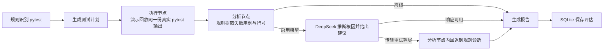

# TestMirror 面试演示｜一次 pytest 失败的三条诊断路径

示例规则是订单金额达到 5,000 分就免运费。三个参数分别是 4,999、5,000 和 5,001 分。初始实现用了 `>`，刚好 5,000 分的订单仍收取 500 分运费。

## 运行

在仓库根目录安装锁定依赖，然后运行演示。每次使用一个新的可写输出目录。

```powershell
uv sync --locked
uv run --locked python -m examples.interview_demo.run --out data/interview-offline
uv run --locked python -m examples.interview_demo.run --live --out data/interview-live
```

第一条演示命令完成离线分析和超时回退。加 `--live` 会用环境变量 `DEEP_SEEK_API_KEY` 或 `DEEPSEEK_API_KEY` 向官方 DeepSeek API 发送合成示例的 pytest 输出和规则提取的失败线索。面试现场可直接使用提前保存的 `comparison.json`。

脚本先运行一次真实 pytest，再把同一份失败输出作为执行节点结果，送进各自的 LangGraph 运行。对照实验固定规则分类，只改变分析节点是否调用模型及其结果。脚本检查 SQLite 中每条评估的原始输出和分析记录，并打印输入的 SHA-256。最后在临时副本中应用已知修复，运行第二次 pytest。

输出目录包括 `pytest-failed.txt`、`pytest-fixed.txt`、`comparison.json` 和 `interview.db`。要演示历史报告，可将现有 Web 服务的 `TESTMIRROR_DATABASE_PATH` 指向这个数据库，然后打开本地界面。三个评估 ID 分别是 `offline`、`deepseek` 和 `timeout`。模型给出的根因也可以在 `comparison.json` 的 `analysis.model_diagnosis.root_cause` 中查看。

## LangGraph 主路径



图中展开了分析节点内部逻辑。模型传输重试由 DeepSeek 客户端处理。本例两次模拟超时后由分析节点捕获并回退，LangGraph 的节点异常重试次数为 0。pytest 断言失败仍会进入分析并落库，评估结论为用例失败。

## 一次实测

| 路径 | 观察结果 |
| --- | --- |
| 离线 | 定位到 `test_shipping.py:11` 和参数化用例 `test_free_shipping_threshold[5000-0]`。实际运费 500 分，预期 0 分。 |
| DeepSeek | `deepseek-chat` 消耗 1,268 tokens。根据失败日志推断应把 `subtotal_cents > 5000` 改成 `subtotal_cents >= 5000`。它也建议增加 4,999 分收取 500 分的测试，现有参数表已覆盖。 |
| 超时 | 在 HTTP 传输层注入 `TimeoutError`。两次尝试后回退，失败线索和根因文字与离线一致。 |
| 修复后 | 将 `shipping.py:3` 的 `>` 改为 `>=`，三条 pytest 用例全部通过。 |

三份失败评估的输入摘要、节点顺序和客观指标一致，均记录 **2 通过、1 失败**。模型根据 pytest 输出提出假设，随后用 `shipping.py` 的实现和复跑结果核实。实验回放已完成的执行结果，报告中的执行耗时取默认值 0。

## 三分钟口述稿

**0:00–0:35**　“我做了一个本地测试诊断工作流。这里一共有三条运费测试，只有刚好达到免运费门槛的用例失败。我用一次 pytest 输出做三条分析路径的对照。”

**0:35–1:15**　“这张图上，LangGraph 管理状态流转。pytest 的计数、断言和文件行号由程序提取。先看离线报告，它告诉我 `test_shipping.py:11` 实际得到 500，期望是 0。打开同一输入的 DeepSeek 报告，对照它建议检查的是实现里的比较运算符。”

**1:15–2:00**　“我把 `>` 改成 `>=`，复跑是 3 通过。这次模型的增量是提出了一个可验证的修改。它也建议补已经存在的边界用例，所以我以测试源码和复跑结果核实建议。”

**2:00–2:40**　“第三条路径模拟模型请求超时。两次请求都超时后，分析节点回退到规则诊断，原始测试结论照常落库。三次失败评估都能从 SQLite 重新读出。这里区分了业务测试失败、模型传输失败和 LangGraph 节点异常。”

**2:40–3:00**　“初版报告里，模型生成的线索会覆盖规则提取的失败行号。我用一个故意返回错误行号的模型响应做回归测试。现在报告保留真实断言位置，模型推断标注待核实，打开历史报告也能核对两者。”
